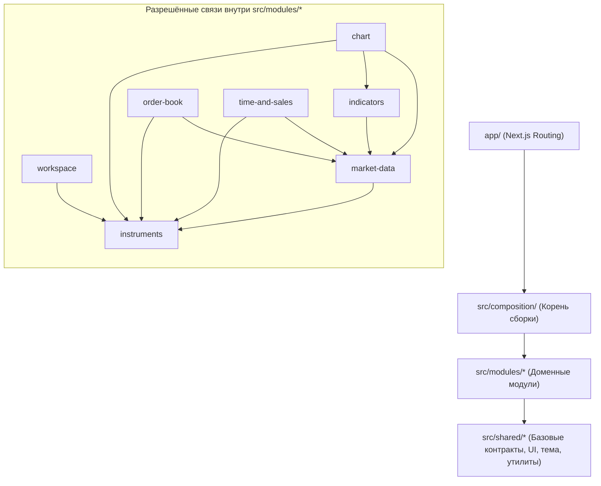

# Архитектурный план: Модульная архитектура Z-Trader

## 1. Главная цель и философия («Заменить проще, чем чинить»)

Проект развивается в сторону полнофункционального веб-терминала уровня NinjaTrader (графики, кастомные индикаторы, инструменты, подключение ML-ботов) и разрабатывается ИИ-агентами.

Архитектура строится на трёх принципах:
1. **Физическая охрана границ:** правила импортов контролируются линтерами (`eslint-plugin-boundaries`, `dependency-cruiser`, `knip`) в pre-commit хуке и в `pnpm check`.
2. **Контракт и чёрный ящик:** у каждого модуля есть единственная точка входа (`index.ts`), паспорт (`README.md`) и внешние тесты, проверяющие только публичный API.
3. **Сменяемость внутренней реализации:** если модуль устарел или требует переработки, его внутренняя реализация (`model/`, `ui/`) удаляется и пересоздаётся заново по контракту `index.ts` и тестам — остальной терминал этого не замечает.

---

## 2. Целевая структура проекта

Next.js-приложение с вертикальными модулями в `src/modules/`, общим фундаментом в `src/shared/` и корнем сборки в `src/composition/`:

```text
z-trader-ai/
├── app/                          # Только роутинг Next.js и глобальные стили (layout.tsx, page.tsx, globals.css)
├── src/
│   ├── composition/              # Корень сборки (Composition Root) — связывает модули через контракты
│   │   ├── widgets.ts            # Реестр плагинов окон (Chart, OrderBook, TimeAndSales...)
│   │   ├── indicators.ts         # Реестр индикаторов
│   │   ├── providers.ts          # Сборка провайдеров рыночных данных и оболочки
│   │   └── tests/                # Интеграционные тесты сборки терминала
│   ├── modules/                  # Независимые доменные модули (вертикальные срезы)
│   │   ├── instruments/          # Каталог инструментов и диалог поиска
│   │   ├── market-data/          # Потоковый сервис котировок/свечей/стакана вне React + адаптеры
│   │   ├── indicators/           # Чистые функции расчёта индикаторов (вход: свечи -> выход: серии)
│   │   ├── chart/                # Виджет графика (обёртка над Lightweight Charts v5)
│   │   ├── order-book/           # Виджет стакана
│   │   ├── time-and-sales/       # Виджет ленты сделок
│   │   └── workspace/            # Оконный менеджер, раскладка, TopBar, персистентность состояния
│   └── shared/                   # Код без доменной бизнес-логики
│       ├── contracts/            # Базовые контракты плагинов (WidgetDefinition, IndicatorDefinition)
│       ├── theme/                # Темизация (dark/light tokens)
│       ├── storage/              # Низкоуровневые обёртки над storage
│       ├── ui/                   # Примитивы интерфейса (кнопки, поповеры, баннеры)
│       └── lib/                  # Утилиты общего назначения
├── tests/
│   ├── e2e/                      # Сквозные браузерные E2E-тесты (Playwright)
│   └── unit/                     # Временные легаси-тесты (до завершения миграции в src/**)
└── docs/
    ├── project-overview.md       # Карта доменов и топология потоков данных
    ├── specs/                    # Спецификации задач и модулей (/spec)
    └── adr/                      # Только действующие архитектурные решения (ADR)
        └── README.md             # Индекс активных ADR
```

---

## 3. Стандарт структуры и мульти-агентный пайплайн разработки

Каждый доменный модуль в `src/modules/<name>/` разделен на **контрактный периметр** и **сменяемую реализацию**:

```text
src/modules/<name>/
├── index.ts        # 🔒 Контрактный периметр: ТОЛЬКО реэкспорт публичного API (типы и рантайм-символы)
├── README.md       # 🔒 Паспорт модуля: назначение, инварианты, ссылки на ADR
├── tests/          # 🔒 Тесты чёрного ящика: импорт ТОЛЬКО из ../index.ts (или @/src/modules/<name>)
│
├── types.ts        # 🛠 Реализация: TypeScript-типы модуля (без рантайм-кода и функций)
├── constants.ts    # 🛠 Реализация: константы и настройки по умолчанию
├── schema.ts       # 🛠 Реализация: Zod-схемы валидации данных
├── model/          # 🛠 Реализация: Zustand-стор, хуки, сервисы, бизнес-логика
└── ui/             # 🛠 Реализация: React-компоненты модуля
```

Сегменты `src/shared/<segment>/` и корень `src/composition/` следуют аналогичному принципу изоляции тестов: внешние тесты располагаются в `tests/` соответствующего сегмента и обращаются только к публичным экспортам.

### Двухсессионный рабочий процесс (`/spec` → `/build`):
1. **Сессия 1 (`/spec`):** Архитектор анализирует доменный контекст, проектирует контрактный шов, формулирует тест-план и фиксирует RFC-спецификацию в `docs/specs/<target>.md` после согласования с разработчиком.
2. **Сессия 2 (`/build`):** Мульти-агентная сборка под управлением оркестратора:
   - **`tester`**: реализует тесты чёрного ящика вслепую по спецификации до написания кода (без доступа к коду реализации).
   - **`coder`**: реализует логику и компоненты строго по контракту и выводу упавших тестов (без доступа к тестам).
   - **Параллельный аудит 4 ревьюеров:**
     - `arch-reviewer`: проверка границ слоёв, правил импортов и изоляции виджетов.
     - `code-reviewer`: качество кода, React 19, TypeScript и защита от утечек памяти.
     - `test-reviewer`: полнота покрытия граничных условий спецификации и отсутствие тавтологических тестов.
     - `ui-reviewer`: соответствие токенам `DESIGN.md`, светлой/тёмной темам и стандартам a11y.
   - **Финал:** строгий прогон `pnpm check`, обновление паспорта `README.md`.

---

## 4. Граф зависимостей и правила границ



### Жёсткие инварианты границ (контролируются ESLint и Dependency Cruiser):
1. **Запрет глубоких импортов:** внешний импорт из внутренних директорий `@/src/modules/<name>/*` запрещён. Разрешён только импорт через публичный шов `@/src/modules/<name>`.
2. **Изоляция виджетов:** виджеты (`chart`, `order-book`, `time-and-sales`) не знают друг о друге и не зависят от `workspace`.
3. **Независимость `workspace` от конкретных виджетов:** `workspace` получает компоненты окон через `src/composition/widgets.ts` по контракту `WidgetDefinition`.
4. **Однонаправленность слоёв:** `shared` не импортирует `modules` или `composition`; `modules` не импортируют `composition` или `app`; код в `src/**` никогда не импортирует легаси-код из `app/**` (односторонний карантин).
5. **Чёрный ящик для тестов:** тесты импортируют только публичные контракты и не обращаются напрямую к внутренним файлам (`model/*`, `ui/*`, `types`, `constants`, `schema`).

---

## 5. Реестр плагинов и контракты взаимодействия

Расширяемость терминала строится вокруг контрактов в `src/shared/contracts/`:

| Точка расширения | Контракт | Назначение |
|---|---|---|
| **Виджеты окон** | `WidgetDefinition` | Содержит `kind`, `title` и `Component: React.ComponentType<WidgetProps>`. Регистрируется в `src/composition/widgets.ts`. |
| **Общение окон** | `WidgetProps` | Стандартизированный интерфейс взаимодействия (`windowId`, `instrument`, `onChangeInstrument`). Группировка по цветам инкапсулирована внутри `workspace`. |
| **Индикаторы** | `IndicatorDefinition` | Функция расчёта `(candles, params) => series` + схема параметров. Регистрируется в `src/composition/indicators.ts`. |
| **Рыночные данные** | `MarketDataProvider` | Адаптер поставщика данных (демо, биржи, брокеры). Входные данные валидируются через **Zod 4**. |
| **ML-боты** | `BotConnector` | Подключение алгоритмических агентов через стандартизированный протокол и Zod-схемы. |

---

## 6. Управление состоянием и потоками данных

| Тип данных | Инструмент | Правила владения |
|---|---|---|
| **Интерфейс и настройки** (окна, геометрия, активный инструмент, тема) | **Zustand** | Изолированный стор в `model/` каждого модуля. Наружу через `index.ts` отдаются только селекторы, хуки и экшены. Сохранение в storage валидируется через **Zod 4**. |
| **Потоковые рыночные данные** (тики, свечи, стакан, лента сделок) | **Сервис вне React** (`src/modules/market-data`) | Единый пул подписок. Компоненты подключаются через `useSyncExternalStore` или передают тики напрямую в Canvas (`Lightweight Charts v5`) без лишних ререндеров React. |

---

## 7. Технологический стек и инструменты контроля

| Категория | Инструмент | Назначение |
|---|---|---|
| **Состояние** | `zustand` | Локальные сторы модулей |
| **Схемы и валидация** | `zod` (v4) | Валидация storage, внешних рыночных API и контрактов интеграции |
| **Графики** | `lightweight-charts` (v5) | Высокопроизводительный Canvas-рендеринг серий и свечей в модуле `chart` |
| **Контроль границ** | `eslint-plugin-boundaries` | Мгновенная проверка правил импортов на уровне файлов и модулей в ESLint |
| **Циклы и архитектура** | `dependency-cruiser` | Проверка графа зависимостей и изоляции виджетов |
| **Неиспользуемый код** | `knip` | Поиск «мёртвого» кода, неиспользуемых экспортов и пакетов |

Все инструменты контроля автоматизированы и входят в обязательный гейт `pnpm check` и `pnpm check:fast`.

---

## 8. Документация и политика решений (ADR)

1. **Паспорт модуля (`src/modules/<name>/README.md`):** фиксирует границы ответственности, публичный API, разрешённые зависимости и поведенческие инварианты.
2. **Журнал решений (`docs/adr/`):** содержит только действующие архитектурные решения ([ADR-0001](../../docs/adr/0001-modular-architecture.md), [ADR-0002](../../docs/adr/0002-boundary-enforcement-and-quarantine.md)). При изменении подхода устаревший ADR удаляется, а мотивы фиксируются в секции альтернатив нового решения.
3. **Обзор топологии ([docs/project-overview.md](../../docs/project-overview.md)):** карта доменов и высокоуровневые потоки данных терминала.

---

## 9. Дорожная карта переезда (Strangler Pattern)

Каждый шаг реализуется изолированно через двухсессионный пайплайн (`/spec` → `/build`). После каждого шага гейт `pnpm check` (включая unit и e2e тесты) остаётся полностью зелёным.

### Фаза 1: Структурный перенос доменов (на текущем стеке)

- **Шаг 1.1 — Перенос фундамента `shared`:**
  - Вынести тему (`theme`), базовые примитивы работы с хранилищем (`storage`), общие UI-компоненты (`ui`), утилиты (`lib`) и базовые контракты плагинов (`contracts/WidgetDefinition`) в `src/shared/`.
  - Покрыть unit-тестами в `src/shared/<segment>/tests/`.
- **Шаг 1.2 — Модуль `instruments`:**
  - Перенести каталог инструментов и диалог поиска в `src/modules/instruments/` с публичным `index.ts`, паспортом `README.md` и модульными тестами в `src/modules/instruments/tests/`.
- **Шаг 1.3 — Модуль `market-data` (демо-источник):**
  - Вынести генерацию и раздачу демо-данных свечей, стакана и ленты сделок за интерфейс провайдера данных в `src/modules/market-data/`.
- **Шаг 1.4 — Виджеты `chart`, `order-book`, `time-and-sales`:**
  - Перенести каждый виджет в отдельный модуль `src/modules/<widget>/`, экспортирующий реализацию `WidgetDefinition`.
- **Шаг 1.5 — Модуль `workspace` и корень сборки `src/composition/`:**
  - Перенести `TerminalShell`, `TerminalWindow`, `WorkspaceCanvas`, `TopBar` и хуки управления окнами в `src/modules/workspace/`.
  - Заменить ветвление по типам окон в `TerminalWindow` на рендеринг через реестр `src/composition/widgets.ts`.
- **Шаг 1.6 — Зачистка легаси-директорий:**
  - Удалить устаревшие папки `app/types`, `app/constants`, `app/hooks`, `app/components`, `app/instruments`, `app/storage`. В `app/` остаются только роуты и стили (`layout.tsx`, `page.tsx`, `globals.css`). Перевести `knip` в строгий режим.

### Фаза 2: Технологическое усиление модулей (по отдельным итерациям)

- **Шаг 2.1 — Внедрение `zod` v4 на границах:**
  - Перевести валидацию состояния `workspace` при чтении из storage и контрактов `market-data` на схемы Zod.
- **Шаг 2.2 — Внедрение `zustand` в `workspace`:**
  - Заменить локальное состояние окон на Zustand-стор внутри `src/modules/workspace/model/` без изменения публичного API модуля.
- **Шаг 2.3 — Потоковое ядро `market-data` и модуль `indicators`:**
  - Реализовать менеджер потоковых подписок вне React и модуль чистых математических функций расчёта индикаторов (`src/modules/indicators/`).
- **Шаг 2.4 — Замена SVG-графика на `lightweight-charts` v5:**
  - Переписать внутренности модуля `src/modules/chart/` на Canvas-движок Lightweight Charts v5 с подключением индикаторов из `indicators`.
