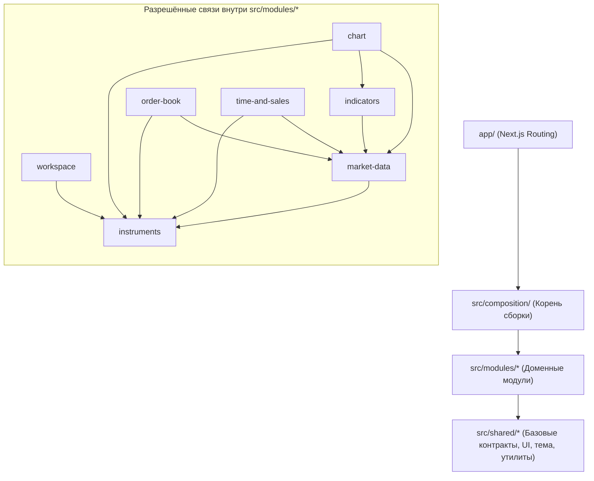

# Архитектурный план: Модульная архитектура Z-Trader

## 1. Главная цель и философия («Заменить проще, чем чинить»)

Проект развивается в сторону полнофункционального веб-терминала уровня NinjaTrader (графики, кастомные индикаторы, инструменты, подключение ML-ботов) и пишется преимущественно ИИ-агентами.

Чтобы проект никогда не зашёл в тупик при росте кодовой базы, архитектура строится на трёх принципах:
1. **Физическая охрана границ:** правила импортов проверяются не обещаниями в промптах, а линтерами (`eslint-plugin-boundaries`, `dependency-cruiser`, `knip`) в pre-commit хуке и CI.
2. **Контракт и чёрный ящик:** у каждого модуля есть единственная точка входа (`index.ts`), паспорт (`README.md`) и внешние тесты, проверяющие только публичный API.
3. **Одноразовость внутренней реализации:** если модуль серьёзно сломан или устарел, его внутренности (`model/`, `ui/`) можно полностью удалить и сгенерировать заново по контракту `index.ts` и тестам — остальной терминал этого даже не заметит.

---

## 2. Целевая структура проекта

Одно Next.js-приложение с вертикальными модулями в `src/modules/`:

```text
z-trader-ai/
├── app/                          # Только роутинг Next.js и глобальные стили
│   ├── layout.tsx
│   ├── page.tsx
│   └── globals.css
├── src/
│   ├── composition/              # Корень сборки (Composition Root) — единственное место, знающее все модули
│   │   ├── widgets.ts            # Реестр плагинов окон (Chart, OrderBook, TimeAndSales...)
│   │   ├── indicators.ts         # Реестр индикаторов
│   │   └── providers.ts          # Сборка провайдеров рыночных данных и оболочки
│   ├── modules/                  # Независимые доменные модули (вертикальные срезы)
│   │   ├── instruments/          # Каталог инструментов и диалог поиска
│   │   ├── market-data/          # Потоковый сервис котировок/свечей/стакана вне React + адаптеры
│   │   ├── indicators/           # Чистые функции расчёта индикаторов (вход: свечи -> выход: серии)
│   │   ├── chart/                # Виджет графика (обёртка над Lightweight Charts v5)
│   │   ├── order-book/           # Виджет стакана
│   │   ├── time-and-sales/       # Виджет ленты сделок
│   │   └── workspace/            # Оконный менеджер, раскладка, TopBar, хранение состояния
│   └── shared/                   # Код без доменной бизнес-логики
│       ├── contracts/            # Базовые контракты плагинов (WidgetDefinition, IndicatorDefinition)
│       ├── theme/                # Темизация (dark/light)
│       ├── storage/              # Низкоуровневые обёртки над localStorage
│       ├── ui/                   # Примитивы интерфейса (кнопки, поповеры, баннеры)
│       └── lib/                  # Утилиты общего назначения
├── tests/
│   └── e2e/                      # Сквозные браузерные E2E-тесты (Playwright) на собранное приложение
└── docs/
    └── adr/                      # Только актуальные архитектурные решения (ADR)
        └── README.md             # Короткий индекс действующих ADR
```

---

## 3. Единый стандарт внутри модуля и связка со слепым TDD

Каждый модуль в `src/modules/<module-name>/` делится на две чёткие зоны — **контрактный периметр** и **сменяемую реализацию**:

```text
src/modules/<name>/
├── index.ts        # 🔒 Контрактный периметр (Architect): ТОЛЬКО реэкспорт публичного API
├── README.md       # 🔒 Паспорт модуля (Architect): назначение, инварианты, ссылки на ADR
├── tests/          # 🔒 Тесты чёрного ящика (Tester): пишут ДО кода, импорт ТОЛЬКО из ../index.ts
│
├── types.ts        # 🛠 Внутренняя реализация (Coder): TS-типы модуля (без рантайм-кода)
├── constants.ts    # 🛠 Внутренняя реализация (Coder): константы и настройки по умолчанию
├── schema.ts       # 🛠 Внутренняя реализация (Coder): Zod-схемы валидации
├── model/          # 🛠 Внутренняя реализация (Coder): Zustand-стор, хуки, сервисы, бизнес-логика
└── ui/             # 🛠 Внутренняя реализация (Coder): React-компоненты модуля
```

### Как работает слепой TDD (`Architect → Tester → Coder → Reviewer`) внутри модуля:
1. **Одна точка стыковки (`index.ts`):** раньше `Tester` и `Coder` должны были вслепую состыковаться по 4 разным папкам (`types/`, `constants/`, `hooks/`, `components/`). Теперь весь контракт модуля сосредоточен в одном входном файле `src/modules/<name>/index.ts`.
2. **Слепой барьер внутри модуля:**
   - **Tester** читает контракт и пишет тесты в `src/modules/<name>/tests/` (и `tests/e2e/`) **до написания кода**, не читая файлы реализации (`model/`, `ui/`).
   - **Coder** реализует `model/` и `ui/`, никогда не заглядывая в `**/tests/**`.
3. **Перезапись сломанного модуля с нуля:** если реализация модуля зашла в тупик, удаляются `model/` и `ui/`, а контрактный периметр (`index.ts`, `README.md`, `tests/`) остаётся нетронутым — `Coder` генерирует новую начинку под существующие тесты.

> [!IMPORTANT]
> **Правила чистоты файлов внутри модуля (проверяются ESLint):**
> - В `types.ts` запрещены рантайм-переменные, функции и `export default`.
> - В `index.ts` запрещены объявления функций, переменных и компонентов — разрешены только `export { ... } from "./..."` и `export type { ... } from "./types"`.
> - Файлам в `src/modules/<name>/tests/**` линтером (`eslint-plugin-boundaries`) запрещено импортировать `../model/*`, `../ui/*`, `../constants` — разрешён импорт **только** из публичного `../index` (`@/src/modules/<name>`).

---

## 4. Граф зависимостей и правила границ



### Жёсткие инварианты границ (проверяются `eslint-plugin-boundaries` и `dependency-cruiser`):
1. **Запрет глубоких импортов:** импорт `@/src/modules/chart/ui/chart` извне модуля `chart` выдаёт ошибку линтера. Разрешён только импорт `@/src/modules/chart`.
2. **Изоляция виджетов:** виджеты (`chart`, `order-book`, `time-and-sales`) **не знают друг о друге** и **не знают о `workspace`**.
3. **Независимость `workspace` от виджетов:** `workspace` не импортирует ни один конкретный виджет — он получает список доступных виджетов из `src/composition/widgets.ts` через контракт `WidgetDefinition`.
4. **Однонаправленность слоёв:** `shared` не может импортировать `modules` или `composition`; `modules` не могут импортировать `composition` или `app`.
5. **Чёрный ящик для тестов:** файлы в `src/modules/<name>/tests/` и `tests/e2e/` могут импортировать из `src/modules/<name>` только публичный `index.ts`.

---

## 5. Реестр плагинов и общение между окнами

Расширяемость строится вокруг контрактов в `src/shared/contracts/`:

| Точка расширения | Контракт | Как работает |
|---|---|---|
| **Виджеты окон** | `WidgetDefinition` | Содержит `kind`, `title`, и `Component: React.ComponentType<WidgetProps>`. Регистрируется в `src/composition/widgets.ts`. |
| **Общение окон** | `WidgetProps` | `workspace` передаёт каждому окну стандартные пропсы (`windowId`, `instrument`, `onChangeInstrument`). Виджет вызывает колбэки пропсов и ничего не знает ни о соседних окнах, ни о группах линковки (Color Groups реализуются внутри `workspace`). |
| **Индикаторы** | `IndicatorDefinition` | Чистая функция расчёта `(candles, params) => series` + метаданные параметров. Регистрируется в `src/composition/indicators.ts`. |
| **Рыночные данные** | `MarketDataProvider` | Адаптер источника данных (сейчас `demo`, позже биржи/брокеры). Входные данные от внешних источников валидируются через **Zod 4**. |
| **ML-боты (будущий этап)** | `BotConnector` | Подключится тем же способом через отдельный реестр и Zod-схемы без переделки ядра. |

---

## 6. Управление состоянием и потоками данных

Мы строго разделяем два типа состояния, чтобы интерфейс не тормозил на реальном потоке котировок:

| Тип данных | Инструмент | Правила владения |
|---|---|---|
| **Состояние интерфейса и настроек** (открытые окна, координаты, активный инструмент, выбранные индикаторы, тема) | **Zustand** | У каждого модуля свой изолированный стор в `model/`. Стор не экспортируется целиком в обход публичного API — наружу из `index.ts` смотрят только узкие хуки/селекторы или экшены. Персистентность состояния `workspace` валидируется при чтении из `localStorage` через **Zod 4**. |
| **Высокочастотные рыночные данные** (тики, свечи, стакан, лента) | **Потоковый сервис вне React** (`src/modules/market-data`) | Единый пул подписок (если открыты 3 окна с `BTCUSDT`, подписка одна). Компоненты подписываются через `useSyncExternalStore` или передают обновления напрямую в canvas графика (`Lightweight Charts v5`), минуя ререндер дерева React. |

---

## 7. Технологический стек и инструменты контроля

| Категория | Выбор | Назначение |
|---|---|---|
| **Состояние** | `zustand` | Локальные сторы модулей вне и внутри React |
| **Контракты на границах** | `zod` (v4) | Валидация `localStorage`, внешних API рыночных данных и будущих ML-ботов (с возможностью генерации JSON Schema) |
| **Графики** | `lightweight-charts` (v5) | Отрисовка свечей, панелей и серий индикаторов на Canvas за внутренним адаптером модуля `chart` |
| **Охрана границ (ESLint)** | `eslint-plugin-boundaries` | Мгновенная проверка правил импортов между `shared`, `modules`, `composition`, `app` и `tests` |
| **Граф и циклы** | `dependency-cruiser` | Проверка отсутствия циклических зависимостей и генерация визуального графа модулей |
| **Чистка мусора за ИИ** | `knip` | Автоматический поиск неиспользуемых файлов, зависимостей и «мёртвых» экспортов в `index.ts` |

Все три инструмента контроля включаются в `pnpm check` и `pnpm check:fast`.

---

## 8. Документация для ИИ и политика ADR

1. **Паспорт модуля (`src/modules/<name>/README.md`):**
   Короткий файл до 1 страницы:
   - Зона ответственности (что модуль делает и чего НЕ делает).
   - Публичный контракт (что экспортируется из `index.ts`).
   - Разрешённые зависимости.
   - Инварианты поведения (что нельзя сломать при полной перезаписи модуля).
   - Ссылки только на те ADR, которые относятся к этому модулю.
2. **Живой журнал решений (`docs/adr/`):**
   - В папке лежат **только действующие** ADR и таблица-оглавление `docs/adr/README.md`.
   - **Политика удаления устаревших ADR:** когда решение меняется, старый файл ADR **удаляется** (чтобы ИИ никогда не читал устаревшие правила), но причина отказа от старого подхода обязательно переносится в раздел `Отвергнутые альтернативы` нового ADR.

---

## 9. Обновление правил проекта (`.agents/rules/` и `.agents/agents/`)

Перед началом переноса кода обновляются проектные правила и пути в профилях агентов:
- [codebase-layout.md](file:///c:/DATA/Development/js/z-trader-ai/.agents/rules/codebase-layout.md) — заменяет старую раскладку `app/types | constants | hooks | components` на модульную структуру `src/modules/<name>/{index.ts, README.md, tests/, types.ts, constants.ts, schema.ts, model/, ui/}`, `src/shared/` и `src/composition/`.
- [naming-conventions.md](file:///c:/DATA/Development/js/z-trader-ai/.agents/rules/naming-conventions.md) — адаптирует правила именований под модульные пути (`@/src/modules/<name>` и `@/src/shared/<segment>`).
- Профили [tester.md](file:///c:/DATA/Development/js/z-trader-ai/.agents/agents/tester.md) и [coder.md](file:///c:/DATA/Development/js/z-trader-ai/.agents/agents/coder.md) — обновляются пути разрешённых папок (`src/modules/*/tests/**` и `tests/e2e/**` для `Tester`; `src/**` кроме `**/tests/**` для `Coder`).

---

## 10. Дорожная карта постепенного переезда (Strangler Pattern)

Главное правило переезда: **сначала чистый структурный перенос без изменения функциональности, затем новые технологии по одной.** После каждого шага `pnpm check` (включая все unit и e2e тесты) обязан быть зелёным.

### Фаза 1: Инфраструктура границ и структурный перенос (на текущем стеке)
- **Шаг 1.0 — Скелет и карантин:**
  - Настроить алиасы путей (`@/src/*`), установить `eslint-plugin-boundaries`, `knip`, `dependency-cruiser`.
  - Ввести в ESLint **односторонний карантин**: коду в `src/**` сразу запрещено (`error`) импортировать что-либо из старых папок `app/types`, `app/constants`, `app/hooks`, `app/components`. Старому коду в `app/` временно разрешено импортировать из `src/**`.
  - Обновить `.agents/rules/codebase-layout.md`, `.agents/rules/naming-conventions.md`, пути в `.agents/agents/{tester,coder}.md` и записать базовые ADR в `docs/adr/`.
- **Шаг 1.1 — Перенос `shared`:**
  - Вынести тему (`theme`), базовые примитивы хранения и общие контракты плагинов (`WidgetDefinition`) в `src/shared/`.
- **Шаг 1.2 — Модуль `instruments` (пилот):**
  - Перенести каталог инструментов и диалог поиска в `src/modules/instruments/` с публичным `index.ts`, `README.md` и модульными тестами в `src/modules/instruments/tests/`.
- **Шаг 1.3 — Модуль `market-data` (демо-источник):**
  - Вынести демо-данные свечей, стакана и ленты сделок за контракт провайдера данных в `src/modules/market-data/`.
- **Шаг 1.4 — Виджеты `chart`, `order-book`, `time-and-sales`:**
  - Перенести каждый виджет в свой модуль `src/modules/<widget>/`, экспортирующий реализацию `WidgetDefinition`.
- **Шаг 1.5 — Модуль `workspace` и корень сборки `src/composition/`:**
  - Перенести `TerminalShell`, `TerminalWindow`, `WorkspaceCanvas`, `TopBar` и хуки окон в `src/modules/workspace/`.
  - Заменить жёсткий `if (window.kind === ...)` в `TerminalWindow` на рендер через реестр `src/composition/widgets.ts`.
- **Шаг 1.6 — Зачистка легаси:**
  - Удалить опустевшие папки `app/types`, `app/constants`, `app/hooks`, `app/components`, `app/instruments`, `app/storage`. В `app/` остаются только `layout.tsx`, `page.tsx`, `globals.css`. Включить `knip` в строгий режим.

### Фаза 2: Технологическое усиление модулей (по одному модулю за итерацию)
- **Шаг 2.1 — Внедрение `zod` v4 на границах:**
  - Перевести валидацию сохранения/чтения рабочего пространства (`workspace`) и контрактов `market-data` на схемы Zod.
- **Шаг 2.2 — Внедрение `zustand` в `workspace`:**
  - Заменить внутреннее состояние окон на Zustand-стор внутри `src/modules/workspace/model/` без изменения публичного контракта модуля.
- **Шаг 2.3 — Потоковое ядро `market-data` и модуль `indicators`:**
  - Реализовать сервис потоковых подписок вне React и модуль чистых функций расчёта индикаторов (`src/modules/indicators/`).
- **Шаг 2.4 — Замена SVG-графика на `lightweight-charts` v5:**
  - Переписать внутренности модуля `src/modules/chart/` на Canvas-движок Lightweight Charts v5 с подключением серий из `indicators`. Остальные модули при этом не затрагиваются.
