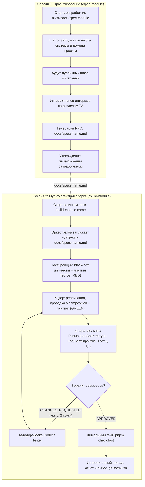

# Архитектурная спецификация модульного воркфлоу разработки

Данный документ фиксирует согласованную архитектуру регулярного пайплайна создания новых модулей для проекта **Z-Trader** с чистого листа на базе правил кодовой базы (`codebase-layout.md`).

---

## 1. Концепция и фундаментальные принципы

Воркфлоу разделен на **два независимых этапа, выполняемых в разных чат-сессиях**, что гарантирует чистоту контекста нейросети и исключает накопление контекстного шума:



---

## 2. Сессия 1: Проектирование (`/spec-module <name>`)

### 2.1. Цель этапа
Создать исчерпывающий, согласованный с разработчиком дизайн-документ (RFC) модуля **до** написания какого-либо кода реализации или тестов.

### 2.2. Порядок выполнения
1. **Шаг 0: Загрузка контекста системы (System & Domain Context):** агент знакомится с архитектурой и назначением терминала Z-Trader (корневая документация, ключевые доменные сущности: воркспейс, стакан, графики, потоки котировок).
2. **Шаг 1: Аудит публичных швов `src/shared/`:** агент сканирует публичные экспорты (`src/shared/contracts/`, `src/shared/ui/`, `src/shared/storage/`, `src/shared/theme/`, `src/shared/lib/`), чтобы гарантировать переиспользование существующих базовых примитивов и исключить дублирование кода (велосипеды).
3. **Шаг 2: Интерактивное интервью:** агент последовательно опрашивает разработчика:
   - Назначение, границы ответственности (In-scope) и ограничения (Non-goals).
   - Публичные TypeScript-типы и Zod-схемы валидации.
   - Внутреннее состояние (Zustand: стейт, экшены, селекторы).
   - UI-компоненты и токены дизайн-системы (`DESIGN.md`).
   - Список поведенческих сценариев для тестов (Given-When-Then и краевые случаи).
   - Точка подключения в `src/composition/` (виджет, индикатор, провайдер) и необходимость Playwright E2E-теста.
4. **Шаг 3: Фиксация RFC:** формируется и сохраняется файл `docs/specs/<name>.md`.
5. **Шаг 4: Утверждение:** разработчик знакомится с документом и утверждает его.

---

## 3. Стандарт спецификации (`docs/specs/<name>.md`) и паспорта (`README.md`)

Используется **двухуровневая модель**:

### 3.1. Полный RFC (`docs/specs/<name>.md`)
Объединяет человеческую читаемость с машинной строгостью для ИИ:
- **YAML Frontmatter:** машиночитаемые метаданные:
  ```yaml
  ---
  module: order-book
  type: widget # widget | domain-slice | service
  status: draft # draft | approved | implemented
  composition_point: src/composition/widgets.ts
  e2e_required: true
  ---
  ```
- **Секция 1: Назначение и границы:** цели, инварианты, исключенные сценарии (Non-goals).
- **Секция 2: Публичный контракт:** точный TypeScript-код интерфейсов `types.ts`, Zod-схем `schema.ts`, констант `constants.ts` и реэкспортов `index.ts`.
- **Секция 3: Модель домена (`model/`):** структура Zustand-хранилища, хуки, сайд-эффекты.
- **Секция 4: UI и стилизация (`ui/`):** иерархия компонентов, классы/токены из `DESIGN.md`, состояния (empty, loading, error).
- **Секция 5: Чеклист сценариев черного ящика (`tests/`):** структурированные Given-When-Then кейсы.
- **Секция 6: Проводка в композит:** регистрация метаданных окна (размеры, заголовок, иконка).

### 3.2. Паспорт модуля (`src/modules/<name>/README.md`)
Генерируется на этапе реализации в Сессии 2 и служит постоянным компактным справочником:
- Назначение и ответственность.
- Публичный интерфейс (`@/src/modules/<name>`).
- Разрешенные зависимости (только `@/src/shared/*`).
- Архитектурные инварианты.
- Ссылка на первоисточник: `docs/specs/<name>.md`.

---

## 4. Сессия 2: Автоматическая сборка (`/build-module <name>`)

### 4.1. Ролевая модель субагентов

| Роль | Входные данные | Права на запись | Выполнение CLI | Запреты и изоляция |
| :--- | :--- | :--- | :--- | :--- |
| **Оркестратор** | ТЗ `docs/specs/<name>.md` | Вся кодовая база | `pnpm check:fast`, координация git | Не пишет код сам, управляет субагентами |
| **Тестировщик** | Спецификация (контракт и чеклист) | Только `src/modules/<name>/tests/*` и `tests/e2e/*` | `vitest run ...`, `eslint` и `prettier` на папке `tests/` | **Строго запрещено** читать или редактировать код реализации (`model/`, `ui/`, `index.ts`) |
| **Кодер** | Спецификация + консольный вывод ошибок тестов | Только файлы реализации модуля и `src/composition/*` | `vitest run ...`, `eslint` и `prettier` на коде модуля | **Строго запрещено** читать исходники тестов или модифицировать папку `tests/` |
| **ArchReviewer** | Git diff + архитектурные правила | Только чтение | Нет | Проверяет границы модулей, слои, карантин `app/` и `depcruise` |
| **CodeReviewer** | Git diff + реализация модуля | Только чтение | Нет | Проверяет качество TypeScript/React кода, декомпозицию, бест-практисы, обработку ошибок |
| **TestReviewer** | Git diff + спецификация ТЗ | Только чтение | Нет | Проверяет качество тестов, покрытие сценариев ТЗ и чистоту «черного ящика» |
| **UIReviewer** | Git diff + `DESIGN.md` | Только чтение | Нет | Проверяет токены `DESIGN.md`, темы (светлая/темная), адаптивность и плотность UI |

---

## 5. Защита от туннельного зрения и зацикливания

### 5.1. Предотвращение туннельного зрения (Принцип Senior Engineer)
Чтобы чеклисты не превращались в шоры, в системные промпты всех 4 рецензентов зашивается **Принцип открытого инженерного аудита**:
- Чеклист конкретной роли — это лишь **минимальный обязательный порог**, а не граница анализа.
- Каждый рецензент выступает в роли **Senior/Staff Engineer**: если CodeReviewer или ArchReviewer видит очевидный риск краша рантайма, утечку памяти, бесконечный ререндер или архитектурную бомбу замедленного действия, которой формально не было в чеклисте — он обязан выставить `BLOCKER` с доказательством сценария сбоя.

### 5.2. Единая хартия всех ревьюеров (Защита от бесконечного цикла)
Чтобы исключить субъективные придирки и бесконечный пинг-понг правок, все 4 ревьюера обязаны следовать **Единой хартии**:

1. **Бинарный порог блокировки (Только объективный BLOCKER):**
   - Статус `CHANGES_REQUESTED` разрешено выставлять **только** за:
     - Падение тестов или статических проверок (`lint`, `typecheck`, `depcruise`);
     - Прямое нарушение обязательного архитектурного правила (`codebase-layout.md`, карантин `app/`);
     - Отсутствие обязательного сценария из утвержденного ТЗ;
     - Реальный баг рантайма, утечку памяти или краш (с описанием сценария воспроизведения).
   - Любая субъективная вкусовщина (названия локальных переменных, «я бы написал этот цикл иначе», мелкие стилистические предпочтения) помечается тегом `SUGGESTION / NIT`, включается в отчет, но **строго не блокирует сдачу (выставляется `APPROVED`)**.
2. **Запрет сдвига ворот (No Moving Goalposts):**
   - На повторной итерации ревьюер проверяет **исключительно измененный дифф**. Новые замечания к коду, который уже присутствовал на первом раунде и не менялся, категорически запрещены.
3. **Глобальный предохранитель (Circuit Breaker):**
   - Максимум **2 раунда автодоработок** на всю задачу. Если замечания не закрыты за 2 цикла — Оркестратор останавливает цикл и выносит решение на суд человека.

---

## 6. Право голоса субагентов (Subagent Voice)

Каждый субагент наделен правом не соглашаться со слепым исполнением, если обнаружена фундаментальная проблема:
- Обнаружен скрытый конфликт правил или противоречие в ТЗ;
- Выявлен критический краевой случай, ломающий предложенную схему данных;
- Найдено альтернативное решение, существенно превосходящее исходное по производительности или простоте.

**Протокол:**
Субагент возвращает статус `NEEDS_INPUT` с описанием проблемы и аргументами. Оркестратор **не имеет права** подавлять этот сигнал и немедленно выносит вопрос разработчику через интерактивный диалог (`ask_question`).

---

## 7. Финализация и сдача задачи

1. **Критерии готовности (Definition of Done):**
   - Тесты модуля `src/modules/<name>/tests/` проходят на 100% (GREEN);
   - Проводка в `src/composition/` выполнена;
   - Все 4 параллельных ревьюера выставили статус `APPROVED`;
   - Проверка `pnpm check:fast` завершилась с кодом 0 внутри песочницы (format, typecheck, lint, depcruise, knip, unit-tests);
   - Паспорт модуля `src/modules/<name>/README.md` сгенерирован и актуален.
2. **Интерактивный финал и верификация:**
   - **Опциональный E2E-прогон:** если модуль добавляет виджет или содержит Playwright E2E-тест, Оркестратор спрашивает разработчика: *«Хотите запустить полный pnpm check (включая Playwright E2E) вне песочницы?»*. При согласии команда выполняется вне песочницы с явным подтверждением в UI («Allow once»).
   - **Итоговый отчет:** Оркестратор выводит структурированную сводку: созданные файлы, покрытие сценариев, вердикты ревьюеров и список неблокирующих предложений (`NIT`).
   - **Выбор git-действия:** разработчик подтверждает создание атомарного git-коммита в ветку или оставляет изменения в рабочей директории для личного ревью в IDE.
