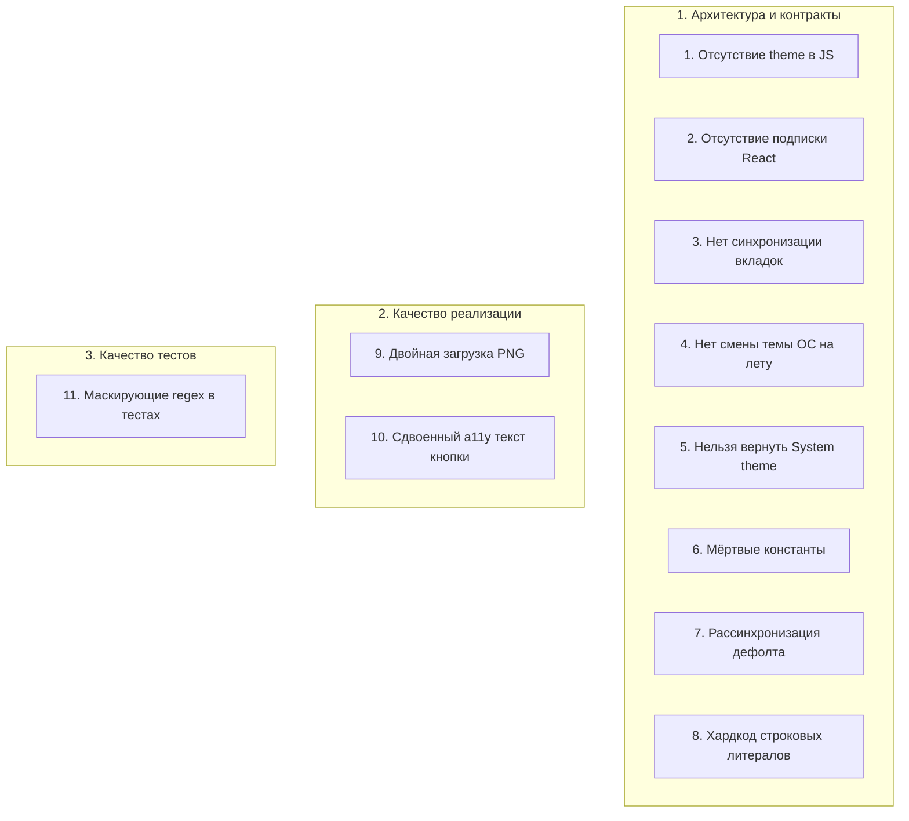

# Ревью архитектуры и реализации подсистемы тем терминала Z-Trader AI

**Идентификатор аудита:** `theme-system_review.md`  
**Дата аудита:** 23 октября 2026 г.  
**Аудитор:** Independent Code & Architecture Reviewer  
**Статус / Вердикт:** `CHANGES_REQUESTED`  
**Общая оценка качества:** `8.5 / 10`  
**Затрагиваемые файлы и модули:**
- [`app/types/theme.ts`](file:///c:/DATA/Development/js/z-trader-ai/app/types/theme.ts)
- [`app/constants/theme.ts`](file:///c:/DATA/Development/js/z-trader-ai/app/constants/theme.ts)
- [`app/constants/storage.ts`](file:///c:/DATA/Development/js/z-trader-ai/app/constants/storage.ts)
- [`app/hooks/use-theme.ts`](file:///c:/DATA/Development/js/z-trader-ai/app/hooks/use-theme.ts)
- [`app/components/theme-toggle.tsx`](file:///c:/DATA/Development/js/z-trader-ai/app/components/theme-toggle.tsx)
- [`app/components/top-bar.tsx`](file:///c:/DATA/Development/js/z-trader-ai/app/components/top-bar.tsx)
- [`app/components/workspace-canvas.tsx`](file:///c:/DATA/Development/js/z-trader-ai/app/components/workspace-canvas.tsx)
- [`app/layout.tsx`](file:///c:/DATA/Development/js/z-trader-ai/app/layout.tsx)
- [`app/globals.css`](file:///c:/DATA/Development/js/z-trader-ai/app/globals.css)
- [`tests/unit/theme.test.tsx`](file:///c:/DATA/Development/js/z-trader-ai/tests/unit/theme.test.tsx)

---

## 1. Резюме аудита (Executive Summary)

Подсистема управления темами терминала Z-Trader решает фундаментальную задачу веб-приложений на Next.js App Router:
* **Zero FOUC (Flash of Unstyled Content):** благодаря парсер-блокирующему синхронному инлайн-скрипту в `<head>` ([`app/layout.tsx`](file:///c:/DATA/Development/js/z-trader-ai/app/layout.tsx#L20-L28)), атрибут `data-theme` выставляется на тег `<html>` до первой отрисовки страницы.
* **Отсутствие ошибок гидратации Next.js (SSR mismatch):** вёрстка не зависит от серверного состояния темы (`suppressHydrationWarning`).
* **Нулевой оверхед по ререндерам (0 re-renders):** переключение темы мутирует только атрибут DOM, позволяя CSS-переменным обновлять стили интерфейса силами браузера без единого ререндера React Fiber.

Однако проведённый аудит выявил **11 узких мест и архитектурных ограничений**, препятствующих интеграции свечных графиков (Canvas/WebGL), раздувающих начальный трафик страницы, нарушающих согласованность источников истины (SSOT) и снижающих качество тестов.

**Итоговый вердикт:** `CHANGES_REQUESTED`. До перехода в статус `APPROVED` требуется устранить блокирующие расхождения SSOT, реализовать реактивную подписку для графиков и скорректировать тесты.

---

## 2. Сводка 11 пунктов дефектов и улучшений

Ниже приведены все 11 выявленных пунктов, сгруппированные по категориям и столпам аудита.



---

### Столп 1: Архитектура, реактивность и SSOT (`[Architecture / Contract]`)

#### Пункт 1. Отсутствие значения текущей темы в JS
* **Категория:** `[Architecture / Contract]`
* **Локация:** [`app/hooks/use-theme.ts:19-21`](file:///c:/DATA/Development/js/z-trader-ai/app/hooks/use-theme.ts#L19-L21)
* **Дефект и влияние:** Хук возвращает только `{ toggleTheme: switchTheme }`. В возвращаемом объекте отсутствует текущее строковое значение темы (`theme: "light" | "dark"`) и булев флаг (`isDark: boolean`). Компоненты графиков цен, свечей, индикаторов и стакана заявок (DOM / Level II) строятся на базе HTML5 Canvas или WebGL, где CSS-переменные напрямую неприменимы: им необходимо получать актуальный шестнадцатеричный или RGB цвет в JavaScript и знать точный момент для вызова `requestAnimationFrame` / перерисовки сцены.
* **Ожидаемое требование:** Расширить публичный контракт хука до `useTheme(): { theme: Theme; isDark: boolean; toggleTheme: () => void; setTheme: (theme: Theme) => void }`.

#### Пункт 2. Отсутствие реактивной подписки компонентов на смену темы
* **Категория:** `[Architecture / Contract]`
* **Локация:** [`app/hooks/use-theme.ts:6-21`](file:///c:/DATA/Development/js/z-trader-ai/app/hooks/use-theme.ts#L6-L21)
* **Дефект и влияние:** Функция `switchTheme` напрямую мутирует `document.documentElement.dataset.theme`. React не оповещается об этом изменении. Невозможно точечно подписать компонент графика на смену темы без внедрения механизма внешней подписки.
* **Ожидаемое требование:** Реализовать интеграцию с внешним хранилищем DOM через `useSyncExternalStore` с подпиской через `MutationObserver` (наблюдение за изменением атрибута `data-theme` на элементе `<html>`). **Инвариант:** не использовать глобальный `React.createContext`, чтобы сохранить нулевые ререндеры для компонентов, не вызывающих `useTheme()`.

#### Пункт 3. Отсутствие синхронизации между открытыми вкладками браузера (Multi-tab Sync)
* **Категория:** `[Architecture / Contract]`
* **Локация:** [`app/hooks/use-theme.ts:12-16`](file:///c:/DATA/Development/js/z-trader-ai/app/hooks/use-theme.ts#L12-L16)
* **Дефект и влияние:** Отсутствует обработчик события `window.addEventListener('storage', ...)`. Трейдеры часто используют многомониторные конфигурации с несколькими вкладками терминала. Переключение темы в одной вкладке оставляет все остальные открытые вкладки в исходном состоянии до перезагрузки страницы (десинхронизация интерфейса).
* **Ожидаемое требование:** Добавить слушатель события `storage` в подписку `useSyncExternalStore`. При изменении ключа `THEME_STORAGE_KEY` другой вкладкой синхронно обновлять `dataset.theme` текущего документа.

#### Пункт 4. Отсутствие реакции на изменение системной темы ОС «на лету»
* **Категория:** `[Architecture / Contract]`
* **Локация:** [`app/layout.tsx:21-28`](file:///c:/DATA/Development/js/z-trader-ai/app/layout.tsx#L21-L28)
* **Дефект и влияние:** Если пользователь ещё не задавал тему вручную в приложении, инлайн-скрипт определяет системное предпочтение через `window.matchMedia('(prefers-color-scheme: dark)')` однократно в момент загрузки. Нет слушателя `change`. Если в операционной системе срабатывает автоматическое вечернее переключение на тёмную тему, терминал остаётся в светлой теме.
* **Ожидаемое требование:** Добавить слушатель `matchMedia('(prefers-color-scheme: dark)').addEventListener('change', ...)` при условии отсутствия пользовательского переопределения в `localStorage`.

#### Пункт 5. Невозможность вернуться к системной теме («System Preference»)
* **Категория:** `[Architecture / Contract]`
* **Локация:** [`app/hooks/use-theme.ts:6-17`](file:///c:/DATA/Development/js/z-trader-ai/app/hooks/use-theme.ts#L6-L17), [`app/types/theme.ts:1`](file:///c:/DATA/Development/js/z-trader-ai/app/types/theme.ts#L1)
* **Дефект и влияние:** Тип `Theme` определён строго бинарно: `"light" | "dark"`. Первый же клик по переключателю навсегда записывает жёсткое значение в `localStorage`. В интерфейсе и API отсутствует способ сбросить выбор назад на следование настройкам операционной системы.
* **Ожидаемое требование:** В типах и логике предусмотреть состояние системной темы (либо метод `resetToSystem()` / удаление ключа из `localStorage`).

#### Пункт 6. «Мёртвые» константы в кодовой базе
* **Категория:** `[Architecture / Contract]`
* **Локация:** [`app/constants/theme.ts:3-4`](file:///c:/DATA/Development/js/z-trader-ai/app/constants/theme.ts#L3-L4)
* **Дефект и влияние:** Константы `DEFAULT_THEME: Theme = "dark"` и `THEMES: readonly Theme[] = ["light", "dark"] as const` объявлены в проекте, но не импортируются и не используются **ни в одном файле** кодовой базы. Это нарушает правила проектной раскладки ([`.agents/rules/codebase-layout.md`](file:///c:/DATA/Development/js/z-trader-ai/.agents/rules/codebase-layout.md)) и создаёт ложное впечатление об используемом контракте.
* **Ожидаемое требование:** Использовать `DEFAULT_THEME` и `THEMES` в местах валидации и начальной инициализации, либо удалить неиспользуемый код.

#### Пункт 7. Рассогласование дефолтной темы между слоями (SSOT Mismatch)
* **Категория:** `[Architecture / Contract]`
* **Локация:**
  - Константа: [`app/constants/theme.ts:4`](file:///c:/DATA/Development/js/z-trader-ai/app/constants/theme.ts#L4) (`DEFAULT_THEME = "dark"`)
  - CSS: [`app/globals.css:1-16`](file:///c:/DATA/Development/js/z-trader-ai/app/globals.css#L1-L16) (`:root { color-scheme: light; --canvas: #ffffff; ... }`)
  - Скрипт: [`app/layout.tsx:22`](file:///c:/DATA/Development/js/z-trader-ai/app/layout.tsx#L22) (`matchMedia ? 'dark' : 'light'`)
* **Дефект и влияние:** В константах задекларирован дефолт `"dark"`. Однако селектор `:root` по умолчанию задаёт параметры светлой темы. Если JavaScript в браузере отключен, заблокирован строгой CSP/плагином или упал до выполнения скрипта, терминал отобразится в белой теме, что противоречит основному дизайн-направлению торгового терминала ([`DESIGN.md`](file:///c:/DATA/Development/js/z-trader-ai/DESIGN.md)).
* **Ожидаемое требование:** Привести селектор `:root` по умолчанию в [`app/globals.css`](file:///c:/DATA/Development/js/z-trader-ai/app/globals.css) в соответствие с `DEFAULT_THEME` (`dark`) или явно синхронизировать дефолтные переменные между CSS и JS.

#### Пункт 8. Хардкод строковых литералов вместо использования типизированных констант
* **Категория:** `[Architecture / Contract]`
* **Локация:** [`app/layout.tsx:25`](file:///c:/DATA/Development/js/z-trader-ai/app/layout.tsx#L25)
* **Дефект и влияние:** Проверка валидности сохранённого значения в `localStorage` реализована вручную: `if (saved === 'light' || saved === 'dark')`. Это нарушает правило использования общих констант ([`.agents/rules/naming-conventions.md`](file:///c:/DATA/Development/js/z-trader-ai/.agents/rules/naming-conventions.md)). При любом расширении списка тем или правил валидации эту проверку легко пропустить.
* **Ожидаемое требование:** Использовать централизованный массив `THEMES` или функцию-тайпгард для валидации сохранённой темы.

---

### Столп 2: Качество реализации и производительность (`[Implementation]`)

#### Пункт 9. Двойная загрузка растровых PNG-изображений брендинга
* **Категория:** `[Implementation]`
* **Локация:**
  - [`app/components/top-bar.tsx:17-59`](file:///c:/DATA/Development/js/z-trader-ai/app/components/top-bar.tsx#L17-L59)
  - [`app/components/workspace-canvas.tsx:47-66`](file:///c:/DATA/Development/js/z-trader-ai/app/components/workspace-canvas.tsx#L47-L66)
* **Дефект и влияние:** В DOM одновременно отрендерены оба варианта логотипов (`theme-light-only` и `theme-dark-only`) с атрибутами `loading="eager"` и `fetchPriority="high"`. Preload scanner современных браузеров инициирует загрузку **всех картинок сразу** (и светлых, и тёмных — суммарно 6 тяжёлых растровых файлов PNG размером до 1448×1086 px), полностью игнорируя CSS-правило `display: none`. Это вдвое раздувает сетевой трафик первой загрузки страницы и ухудшает метрику LCP (Largest Contentful Paint).
* **Ожидаемое требование:**
  1. Отрендерить только один нужный ресурс, основываясь на реактивном состоянии `isDark` из `useTheme()`;
  2. Либо использовать нативный тег `<picture>` с источниками `<source media="(prefers-color-scheme: dark)">`;
  3. Либо перевести монохромные элементы логотипов на векторный SVG со свойством `currentColor` и CSS-переменными.

#### Пункт 10. Сдвоенный текст кнопки переключения темы для скринридеров при сбое CSS
* **Категория:** `[Implementation]`
* **Локация:** [`app/components/theme-toggle.tsx:9-40`](file:///c:/DATA/Development/js/z-trader-ai/app/components/theme-toggle.tsx#L9-L40)
* **Дефект и влияние:** Внутри одной кнопки отрендерены сразу два элемента `<span className="sr-only">`: `"Switch to dark theme"` и `"Switch to light theme"`. Сокрытие одного из них возложено исключительно на CSS-правило `.theme-dark-only { display: none }`. При задержке применения стилей, в headless/jsdom средах без CSS-парсера или при сбое загрузки таблицы стилей доступное имя кнопки считывается скринридером как единая склеенная строка: *"Switch to dark themeSwitch to light theme"*. Кроме того, кнопка не сообщает о своём текущем состоянии (отсутствуют атрибуты `aria-pressed` или `role="switch"`).
* **Ожидаемое требование:**
  1. Рендерить только один актуальный `<span className="sr-only">` в зависимости от активной темы;
  2. Добавить семантический атрибут состояния: `aria-pressed={isDark}` или `role="switch"` с `aria-checked={isDark}`.

---

### Столп 3: Тесты и доказательная база (`[Tests]`)

#### Пункт 11. Маскирующие проверки в юнит-тестах
* **Категория:** `[Tests]`
* **Локация:** [`tests/unit/theme.test.tsx:79-81`](file:///c:/DATA/Development/js/z-trader-ai/tests/unit/theme.test.tsx#L79-L81)
* **Дефект и влияние:** Тестовый селектор:
  ```typescript
  const button = screen.getByRole("button", {
    name: /Switch to (light|dark) theme/,
  });
  ```
  использует нестрогое регулярное выражение, пропускающее любое из двух названий. Поскольку в тестовой среде jsdom глобальный CSS `display: none` не обрезает `textContent`, кнопка фактически содержит оба текста одновременно, и регулярное выражение успешно срабатывает, **маскируя дефект доступности**.
  Кроме того, в тестовом наборе полностью отсутствуют проверки:
  - Реактивного обновления хука `useTheme`;
  - Межвкладочной синхронизации через `StorageEvent`;
  - Реакции на `MutationObserver` при программной смене темы.
* **Ожидаемое требование:** Заменить регулярное выражение в тестах на строгое совпадение с ожидаемым текущим лейблом (например, `"Switch to light theme"` при активной темной теме). Добавить тесты на `useSyncExternalStore`, эмуляцию `StorageEvent` и сохранение нулевых каскадных ререндеров.

---
