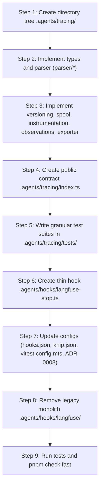

# Refactoring Plan: Langfuse Tracing Subsystem Architecture (`.agents/tracing/`)

## 1. Context and Goals

As part of establishing the first telemetry layer of the Self-Improving Loop, the monolithic files `.agents/hooks/langfuse/langfuse-stop-hook.ts` and `transcript-parser.ts` are being decomposed.
The goals of this refactoring are:

- Make the lifecycle hook `.agents/hooks/langfuse-stop.ts` an ultra-thin event adapter (~30–40 lines).
- Extract all domain telemetry logic into an independent, modular subsystem at `.agents/tracing/`.
- Decompose responsibilities strictly following the Single Responsibility Principle (SRP) in alignment with Langfuse JS/TS SDK v6 standards (`@langfuse/tracing`, `@langfuse/otel`).
- Keep the external third-party skill `.agents/skills/langfuse/` untouched.

---

## 2. Target File Structure

```text
.agents/
├── hooks.json                           # Updated hook command invoking hooks/langfuse-stop.ts
├── hooks/
│   └── langfuse-stop.ts                 # Thin CLI event adapter for Antigravity
└── tracing/                             # Internal telemetry engine
    ├── PLAN.md                          # Subsystem architectural refactoring plan
    ├── index.ts                         # Public subsystem contract
    ├── types.ts                         # Clean interfaces and types
    ├── instrumentation.ts               # OpenTelemetry NodeSDK, LangfuseSpanProcessor, flush/shutdown
    ├── observations.ts                  # Observation emission, propagateAttributes, createTraceId
    ├── versioning.ts                    # Release/version resolution (Git commit SHA + sha256(.agents))
    ├── spool.ts                         # Deduplication cursor and fail-open spool buffer management
    ├── exporter.ts                      # Full-lifecycle turn export orchestrator
    ├── parser/                          # Granular JSONL transcript parser
    │   ├── index.ts                     # Public parser contract
    │   ├── jsonl-reader.ts              # JSONL stream reader and basic step validation
    │   ├── timing-extractor.ts          # ISO timestamp extractor (Created At / Completed At)
    │   ├── tool-deserializer.ts         # Tool arguments deserializer (handling double-encoding)
    │   ├── tagger.ts                    # Automatic tagging (module:* and skill:*)
    │   ├── subagent-resolver.ts         # Recursive filesystem resolver for subagent logs
    │   └── turn-builder.ts              # Turn grouping, token summation, observation hierarchy builder
    └── tests/                           # Modular test suites
        ├── parser.test.ts               # Tests for parser components, timings, tool args, subagent trees
        ├── versioning.test.ts           # Tests for context hash calculation and test file exclusion
        ├── spool.test.ts                # Tests for cursor tracking and fail-open spool buffer
        └── exporter.test.ts             # End-to-end export integration test via OTel/Langfuse
```

---

## 3. Module Details and Responsibilities

### 3.1. Thin Hook `.agents/hooks/langfuse-stop.ts`

- **Responsibility**: Read stdin, parse CLI arguments (`--dry-run`, `--transcript`, `--conversation-id`), invoke the orchestrator function `runStopHook`, and output `{ decision: "allow" }` to stdout.
- **Invariant**: Strict size limit of 35–45 lines; zero direct OpenTelemetry imports or parsing logic.

### 3.2. Subsystem `.agents/tracing/`

1. **`types.ts`**:
   - Export interfaces: `StopHookInput`, `RunStopHookOptions`, `RunStopHookResult`.
   - Export structures: `ContextAnchor` / `ReleaseContext`.
   - Export state types: `LangfuseCursorState` and `PendingExportSpool`.
   - Observation hierarchy types: `ParsedTurnTrace`, `ParsedGenerationObservation`, `ParsedToolObservation`, `ParsedAgentObservation`.
2. **`versioning.ts`**:
   - `computeContextAnchor(workspaceRoot: string): ContextAnchor`.
   - Execute git commands (`rev-parse HEAD`, `status --porcelain`).
   - Deterministic collection and SHA-256 calculation across `.agents/` customizations and `AGENTS.md` (excluding tests and runtime files).
3. **`spool.ts`**:
   - `readCursorState` / `writeCursorState` for `.langfuse-cursor.json`.
   - `readPendingSpool` / `writePendingSpool` for `.pending-export.json`.
   - `mergeTurnsForExport` — deduplicate and combine queues indexed by `turnIndex`.
4. **`instrumentation.ts`**:
   - Instantiate `LangfuseSpanProcessor` (supporting noop exporter for dry-runs and tests).
   - Start and shut down `NodeSDK` (`@opentelemetry/sdk-node`).
   - Function `flushAndShutdown` with timeout bounds (`DEFAULT_TIMEOUT_MS = 4500`).
   - Manage tracer provider lifecycle via `setLangfuseTracerProvider`.
5. **`observations.ts`**:
   - `createTurnTraceId(turn: ParsedTurnTrace): Promise<string>`.
   - `emitRootObservation(turn, contextAnchor, parentSpanContext)` invoking `propagateAttributes`.
   - Recursively traverse and invoke `startObservation` for generation, tool, and agent observation nodes.
6. **`exporter.ts`**:
   - Main function: `runStopHook(input: StopHookInput, options?: RunStopHookOptions): Promise<RunStopHookResult>`.
   - Coordinates transcript ingestion, cursor checks, version computation, span export, and fail-open spool persistence.
7. **`index.ts`**:
   - Single public entry point re-exporting `runStopHook`, `computeContextAnchor`, types, and parser utilities.

### 3.3. Granular Parser `.agents/tracing/parser/`

1. **`jsonl-reader.ts`**: Stream JSONL content, filter corrupt lines, resolve full path via `resolveFullTranscriptPath`.
2. **`timing-extractor.ts`**: Regex extraction of `Created At: ...` / `Completed At: ...` headers, ISO timestamp parsing with fallback.
3. **`tool-deserializer.ts`**: Clean double JSON-encoded tool argument values (`deserializeToolArgs`).
4. **`tagger.ts`**: Recursively extract `module:<name>` and `skill:<name>` tags from tool call arguments.
5. **`subagent-resolver.ts`**: Implement `createFilesystemSubagentResolver` to locate subagent `transcript_full.jsonl` files on disk.
6. **`turn-builder.ts`**: Group raw steps into turns (starting at `USER_INPUT`), sum token usage, and construct observation tree (`llm-generation`, `tool`, `agent:subagent:*`).
7. **`index.ts`**: Public facade re-exporting `parseTranscriptTurns`, `extractUserRequest`, `resolveFullTranscriptPath`, `createFilesystemSubagentResolver`.

---

## 4. Migration Execution Steps



1. **Directory Structure Setup**:
   - Create `.agents/tracing/parser/` and `.agents/tracing/tests/`.
2. **Logic Extraction and Decomposition**:
   - Decompose `transcript-parser.ts` into 6 granular files under `parser/`.
   - Decompose `langfuse-stop-hook.ts` into `versioning.ts`, `spool.ts`, `instrumentation.ts`, `observations.ts`, and `exporter.ts`.
3. **Thin Hook Creation**:
   - Author `.agents/hooks/langfuse-stop.ts` delegating to `runStopHook` from `../tracing/index.ts`.
4. **Configuration Updates**:
   - `.agents/hooks.json`: Update command path to `hooks/langfuse-stop.ts`.
   - `knip.json`: Configure entry point `.agents/hooks/langfuse-stop.ts` and `.agents/tracing/index.ts`.
   - `vitest.config.mts`: Add glob pattern `.agents/tracing/tests/**/*.test.ts`.
   - `docs/adr/0008-langfuse-native-self-improving-agent-flywheel.md`: Add `.agents/tracing` to `applies_to` and run `pnpm adr:sync`.
5. **Legacy Cleanup**:
   - Delete `.agents/hooks/langfuse/` directory completely.
6. **Verification**:
   - Execute `pnpm test:unit` to verify all 4 test suites.
   - Run `pnpm check:fast` (Prettier, Typecheck, ESLint, Depcruise, Knip, ADR Check).

---

## 5. Definition of Done

- [ ] Hook `.agents/hooks/langfuse-stop.ts` is ≤ 45 lines and operates strictly as a stdin/stdout event adapter.
- [ ] Telemetry logic is encapsulated in `.agents/tracing/` with clean single-responsibility files.
- [ ] Directory `.agents/hooks/langfuse/` is completely removed.
- [ ] External skill `.agents/skills/langfuse/` remains untouched.
- [ ] All Vitest suites in `.agents/tracing/tests/` pass with 100% success.
- [ ] `pnpm check:fast` exits with code 0 (zero circular dependencies, zero dead exports according to Knip).
